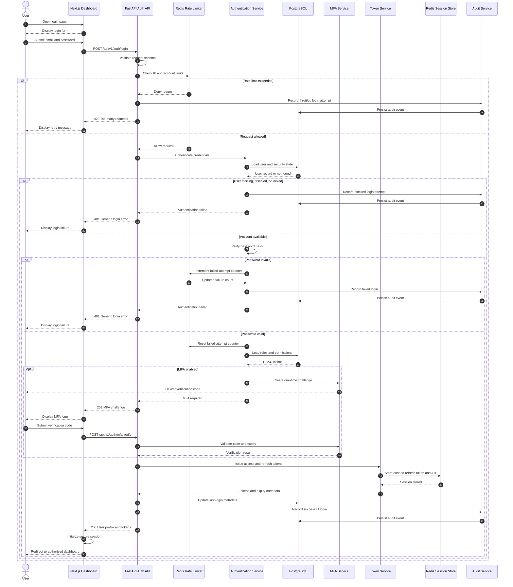
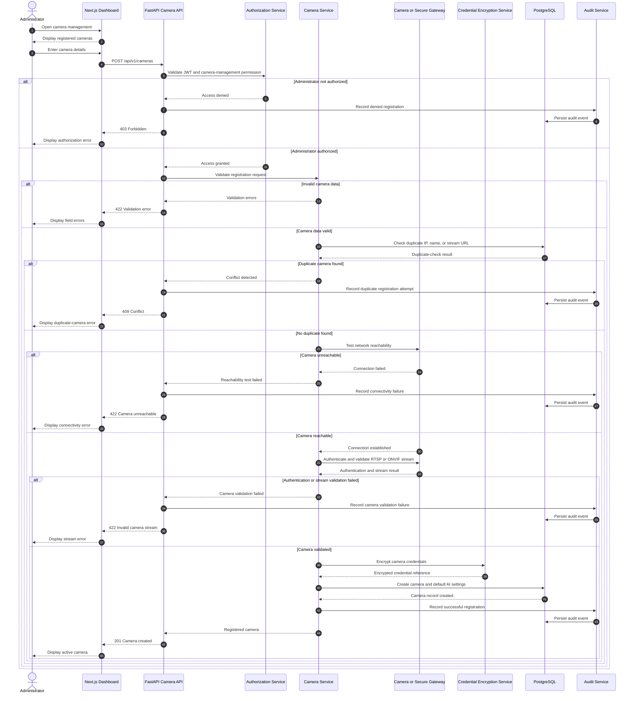
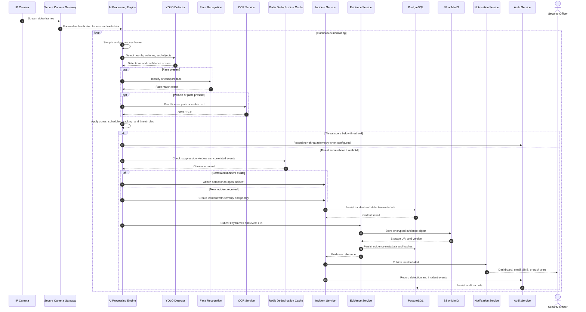
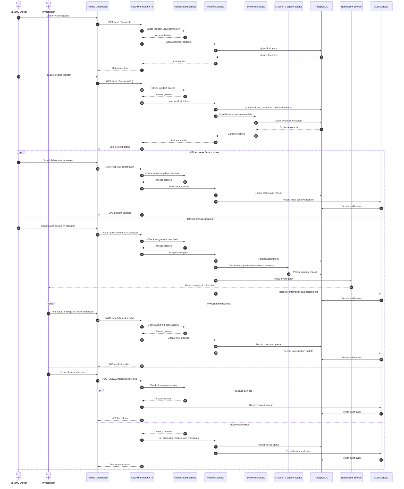
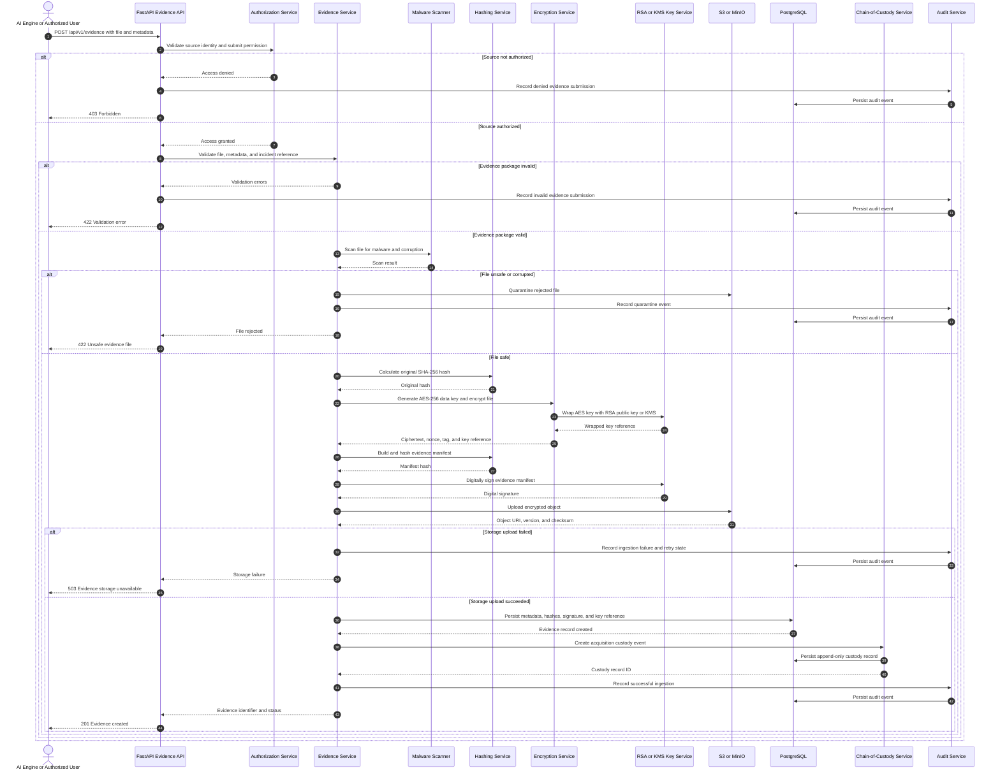
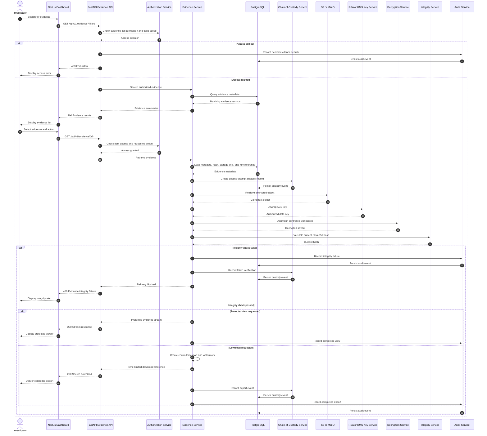
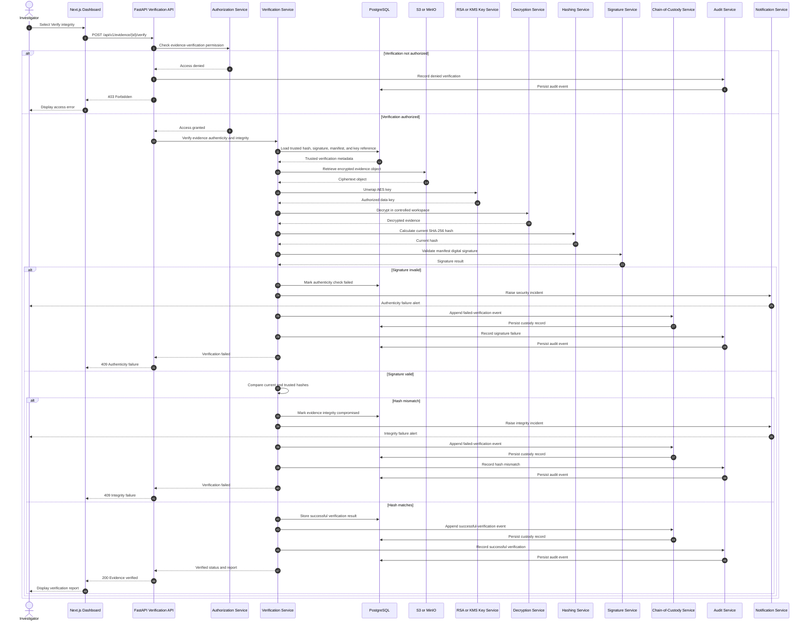
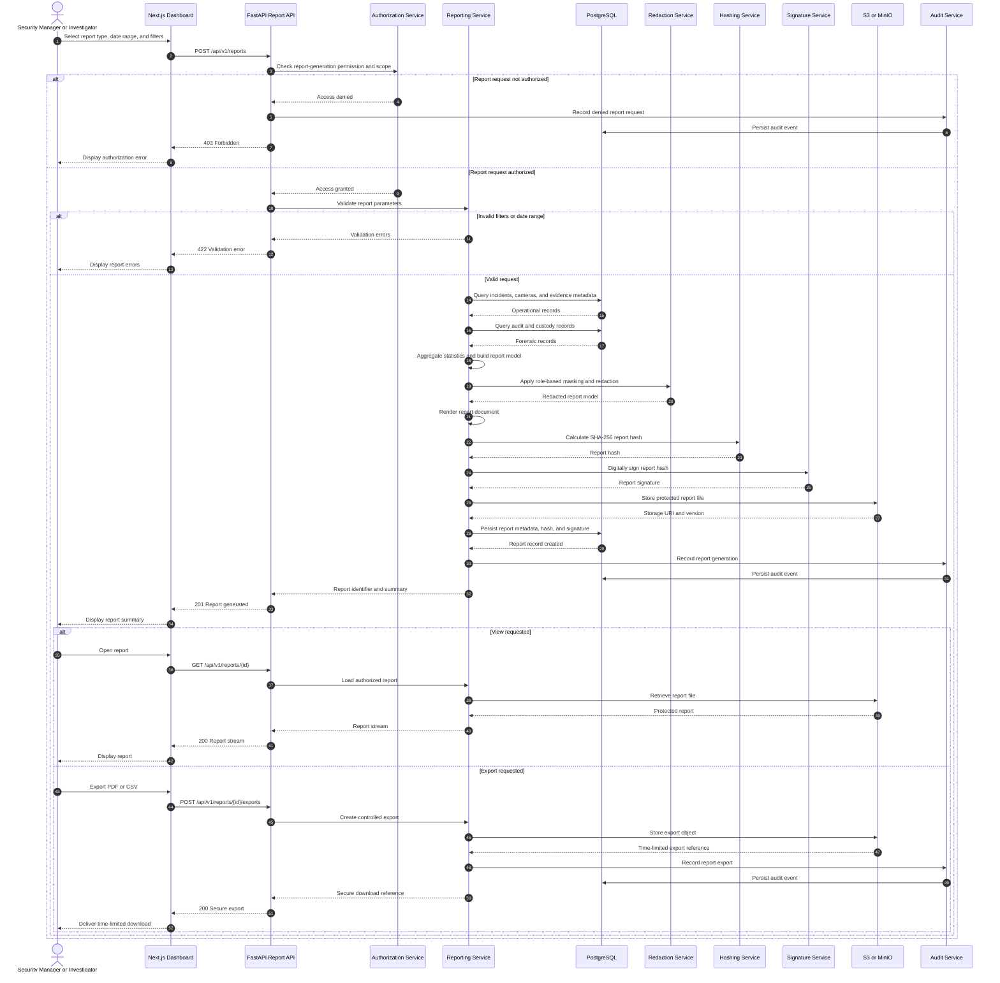
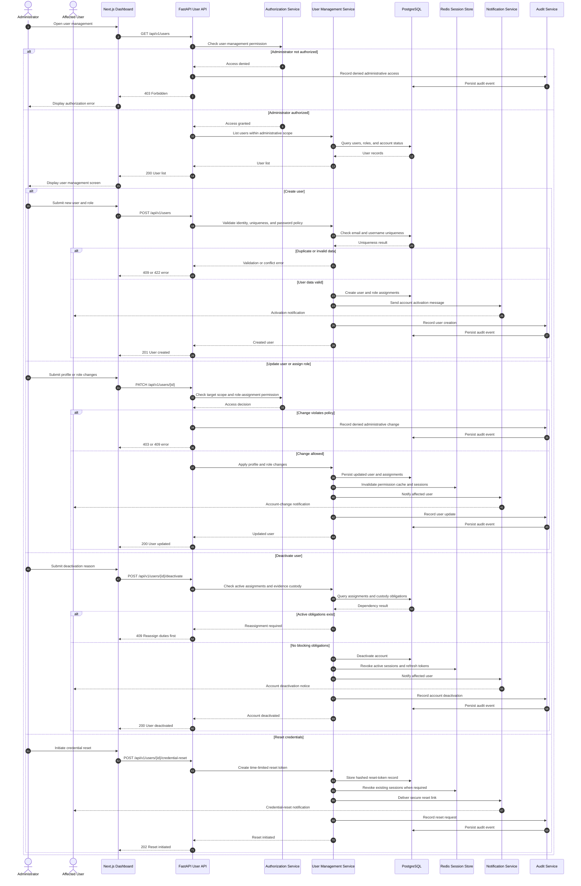

# Secure Surveillance Platform — All Sequence Diagrams

## 01-user-authentication.mmd



## 02-camera-registration.mmd



## 03-ai-threat-detection.mmd



## 04-incident-management.mmd



## 05-evidence-ingestion.mmd



## 06-evidence-retrieval.mmd



## 07-evidence-verification.mmd



## 08-chain-of-custody.mmd

```mermaid
sequenceDiagram
    autonumber
    actor Actor as Authorized User or Trusted Service
    participant Web as Dashboard or Service Client
    participant API as FastAPI Custody API
    participant Authz as Authorization Service
    participant Custody as Chain-of-Custody Service
    participant Evidence as Evidence Service
    participant Hash as Hashing Service
    participant Sign as Signature Service
    participant DB as PostgreSQL
    participant Audit as Audit Service
    participant Notify as Notification Service

    Actor->>Web: Initiate evidence action
    Web->>API: POST /api/v1/evidence/{id}/custody-events
    API->>Authz: Check actor, role, case scope, and action permission

    alt Action not authorized
        Authz-->>API: Access denied
        API->>Audit: Record denied custody action
        Audit->>DB: Persist audit event
        API-->>Web: 403 Forbidden
        Web-->>Actor: Display authorization error
    else Action authorized
        Authz-->>API: Access granted
        API->>Custody: Create custody event
        Custody->>Evidence: Load evidence and current custody state
        Evidence->>DB: Query evidence and latest custody record
        DB-->>Evidence: Evidence and custody state
        Evidence-->>Custody: Current state

        alt Invalid evidence or custody state
            Custody->>Audit: Record invalid custody transition
            Audit->>DB: Persist audit event
            Custody-->>API: Transition rejected
            API-->>Web: 409 Invalid custody transition
            Web-->>Actor: Display custody error
        else State valid
            alt Transfer event
                Custody->>Notify: Request receiving-custodian acceptance
                Notify-->>Actor: Acceptance workflow
                Actor->>Web: Submit acceptance decision
                Web->>API: POST acceptance decision
                API->>Custody: Validate acceptance

                alt Transfer rejected
                    Custody->>Audit: Record rejected transfer
                    Audit->>DB: Persist audit event
                    Custody-->>API: Transfer cancelled
                    API-->>Web: 409 Transfer rejected
                else Transfer accepted
                    Custody->>Custody: Capture sender, receiver, reason, and timestamps
                end
            else Create, view, export, verify, or return event
                Custody->>Custody: Capture action-specific metadata
            end

            Custody->>Custody: Reference previous custody record
            Custody->>Hash: Hash canonical custody payload
            Hash-->>Custody: Custody-record hash
            Custody->>Sign: Digitally sign custody-record hash
            Sign-->>Custody: Digital signature
            Custody->>DB: Append immutable custody record

            alt Persistence failed
                DB-->>Custody: Write failure
                Custody->>Audit: Record custody persistence failure
                Audit->>DB: Persist audit event
                Custody-->>API: Evidence action blocked
                API-->>Web: 503 Custody service unavailable
            else Persistence succeeded
                DB-->>Custody: Custody record ID
                Custody->>Evidence: Execute authorized evidence action
                Evidence-->>Custody: Action result
                Custody->>Audit: Record completed custody action
                Audit->>DB: Persist audit event
                Custody-->>API: Updated custody history
                API-->>Web: 201 Custody event created
                Web-->>Actor: Display updated custody history
            end
        end
    end
```

## 09-report-generation.mmd



## 10-user-management.mmd


