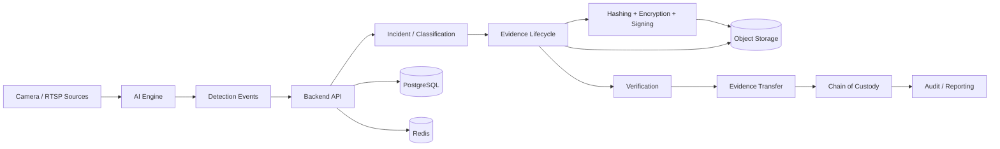
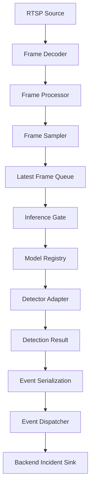
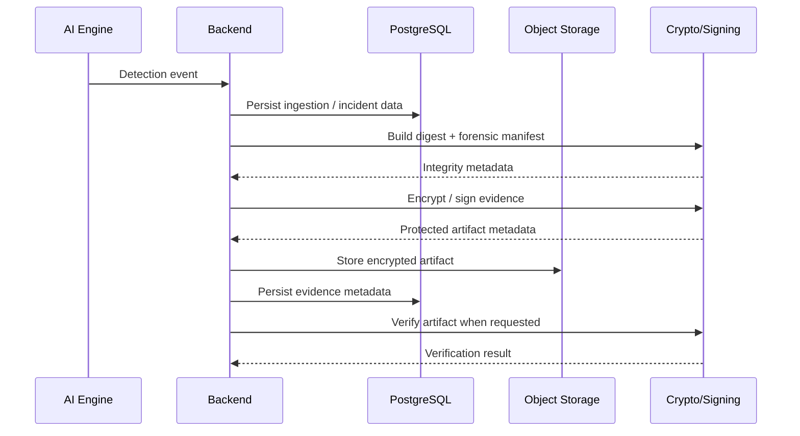

# Architecture Overview

## 1. System context

The platform is split into two major application services:

1. **AI Engine** — consumes camera/RTSP streams, performs frame processing and model inference, and emits structured detection events.
2. **Backend API** — owns authentication, authorization, incidents, evidence, persistence, verification, transfers, custody, auditing, and reporting.

Supporting infrastructure includes PostgreSQL, Redis, MinIO/object storage, Docker-based environments, and a synthetic RTSP test stack.



## 2. AI engine

The AI engine separates model concerns from streaming concerns.



Important boundaries include:

- detector protocol/schema layer
- model registry
- model lifecycle
- device selection
- inference gate
- RTSP source and reconnect policy
- frame queue/sampling
- event serialization/dispatch
- backend event sink

The production detector adapter is under `ai-engine/models/ultralytics_detector.py`.

## 3. Backend layering

The backend uses feature modules under `backend/app/modules/`.

Typical responsibilities are:

```text
Router
  ↓
Service / Domain Logic
  ↓
Repository / Persistence
  ↓
SQLAlchemy Models
  ↓
PostgreSQL
```

Routers should remain transport-focused. Security and domain invariants belong in service/domain layers and supporting infrastructure.

Current feature areas include authentication, users, RBAC, AI ingestion, incidents, incident classification, evidence, custody, audit, health, cameras, reports, and notifications.

## 4. Evidence lifecycle

The evidence domain is deliberately more than file storage.



## 5. Data model

The current backend model graph contains 24 ORM tables, including:

- users, roles, permissions, user_roles, role_permissions
- cameras, sites, camera_ai_configs
- ai_models, detection_events
- incidents, incident_assignments, incident_notes
- evidence, evidence_keys, evidence_verifications, evidence_transfers
- chain_of_custody
- audit_logs
- notifications
- reports, report_incidents, report_exports
- auth_sessions

The primary ERD is maintained under `Architecture Design/`.

## 6. Infrastructure

The repository contains Docker/Compose artefacts for the backend, frontend, AI engine, PostgreSQL, Redis, MinIO, and RTSP testing.

The exact active Compose topology should be verified from the relevant Compose files before treating every service as part of the same deployed environment.

## 7. Architectural invariants

- Authentication and authorization must be explicit at protected boundaries.
- Evidence integrity must survive storage and transfer.
- Cryptographic verification must fail closed.
- Audit and custody records are designed as append-only records.
- Idempotency is required for sensitive write workflows where specified by the API contract.
- Database migrations must preserve forensic immutability constraints.
- The AI engine remains model-independent through detector contracts/adapters.
